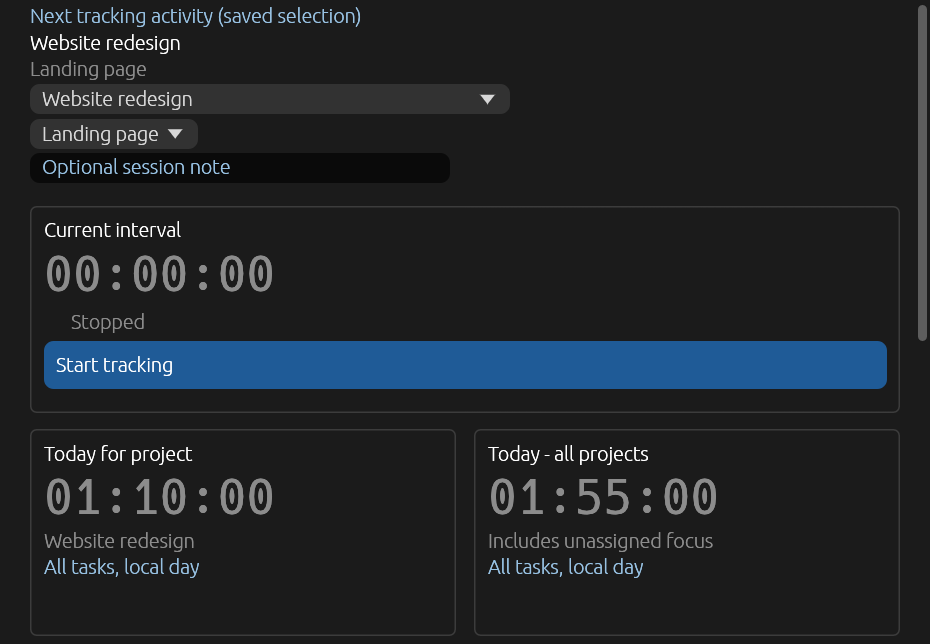
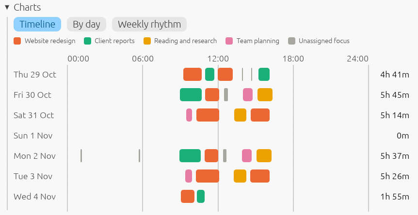

# Attention Focus

A small Windows tray application that records the time you choose to spend on projects
and tasks. Pick an activity, start the timer, and see where your time went.

It stays on your computer. There are no accounts, network access or telemetry, and it does
not watch your screen or keyboard or score your productivity. Time is what you declare, not
what a program guesses.





The examples show invented projects.

## Features

- **Tray first.** Double-click the tray icon to start or stop, click to open the window, and
  hover to see the current session and today's time.
- **Your own list.** Keep projects and tasks in the application, or track unassigned focus.
- **One-click switching.** Changing project or task saves the old interval and starts the
  next at the same moment, so nothing is lost or counted twice.
- **Handles interruptions.** Locking Windows, sleep and shutdown stop the timer without
  resuming on their own. After a crash, you review the last saved checkpoint.
- **Clean days.** An interval crossing midnight is split at the day start, which you can turn
  off. Totals stay correct across time zones and daylight-saving changes either way.
- **Reports.** See totals by project, task and day for any period, in any time zone. Periods can
  follow the current day. Export to CSV or Markdown.
- **Charts.** A timeline of when you worked, columns of how much per day, and your weekly rhythm.
- **Light and dark themes** that follow Windows automatically, or the one you choose.
- **Thirteen languages**, following Windows or your choice: English, Russian, German, French,
  Spanish, Portuguese (Brazil), Italian, Polish, Turkish, Chinese (Simplified), Japanese, Korean
  and Arabic. Translations are machine-made, and corrections are welcome.
- **Starts with Windows** if you want it to, optionally hidden in the tray.

## Install

Windows x64 only. Download `AttentionFocus-VERSION-windows-x64.zip` from
[Releases](../../releases), extract it, and run `attention-focus.exe`. Only the EXE is needed;
the archive also contains a PDF guide, license notices and a `release.json` with file hashes.

The EXE is not code-signed yet, so Windows SmartScreen may warn about it the first time. Choose
**More info**, then **Run anyway**, if you trust the download. See the
[code signing policy](#code-signing-policy).

Read the [user guide](docs/user-guide.md) to get started.

## Your data

History and settings live in `%LOCALAPPDATA%/AttentionFocus/Production`, in SQLite and
text files, and moving the EXE does not affect them. They are not encrypted. Upgrades that
change the history format back it up first, and older versions cannot open upgraded history.

## Build from source

You need Windows x64, the MSVC C++ build tools with the Windows SDK, and `rustup`, which
installs the toolchain pinned in `rust-toolchain.toml`.

```powershell
cargo test --locked
./scripts/dev.ps1
```

`./scripts/dev.ps1` runs a separate **Development** profile, so experiments never touch your
normal history. See [docs/DEVELOPMENT.md](docs/DEVELOPMENT.md) for release packaging and
[docs/ARCHITECTURE.md](docs/ARCHITECTURE.md) for the design.

## Project status

This is a personal project in active development. Editing recorded time and global shortcuts
are not implemented yet. Windows tray, sleep and multi-monitor behavior is checked by hand,
not exhaustively, and compatibility with a clean Windows installation has not been verified.

Contributions and bug reports are welcome; see [CONTRIBUTING.md](CONTRIBUTING.md) and
[SECURITY.md](SECURITY.md).

This repository is developed with AI coding agents. [AGENTS.md](AGENTS.md) is their working
contract, [docs/decisions](docs/decisions/README.md) records why things are the way they are,
and [tasks](tasks/INDEX.md) keeps the work history.

## Code signing policy

Release executables are not code-signed yet. The project intends to apply for the free signing
that [SignPath Foundation](https://signpath.org) offers to open source projects, which needs a
first public release. This section will say so when signing is in effect. Until then, the
`release.json` file in each archive lists the SHA-256 hash of every file.

Releases are built from this repository's source by the
[release workflow](.github/workflows/release.yml) on GitHub-hosted runners. Once signing is in
effect, a person approves each signature.

- Committers, reviewers and approvers: [orwrkr](https://github.com/orwrkr), the repository owner.
- Privacy: this program will not transfer any information to other networked systems unless
  specifically requested by the user. It contains no network features of its own.

## License

[MIT](LICENSE). Release archives include notices for third-party components.
